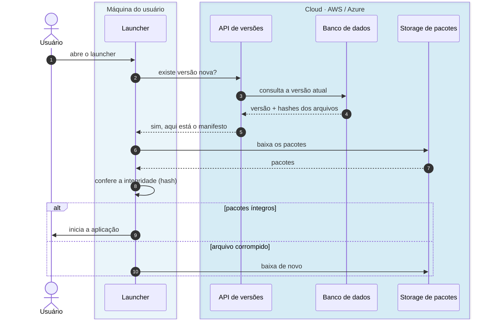

<!-- ===================================================================== -->
<!--  Troque SEU_USUARIO pelo seu usuário do GitHub (Ctrl+H no editor).    -->
<!--  Envie também a pasta assets/ e o arquivo .github/workflows/snake.yml -->
<!-- ===================================================================== -->

<p align="center">
  
</p>

## `01` Sobre mim

Estudante de **Engenharia de Software** com foco em **arquitetura de software**, **launchers** e **infraestrutura**.

Gosto de olhar para o sistema inteiro: como o código se organiza por dentro, como ele chega até a máquina de quem usa e como continua atualizado depois disso.

Minha base vem de Ciência da Computação, com o **CS50 de Harvard** e o **Computer Science** da Codecademy, e de formações em **Java**, **AWS**, **Microsoft Azure** e **Red Hat**.

- Atualmente programo em **C#, Java, C++ e JavaScript**
- Uso bancos **relacionais** (MySQL, PostgreSQL) e **NoSQL** (MongoDB)
- Estudo **cloud** na **AWS** e na **Azure**
- Meta: transformar ideias em projetos.

```csharp
public sealed class IsaqueSantosBomfim
{
    public string   Status        => "Estudante de Engenharia de Software";
    public string[] Foco          => ["Arquitetura de Software", "Launchers", "Infraestrutura"];

    public string[] Linguagens    => ["C#", "Java", "C++", "JavaScript"];
    public string[] BancosDeDados => ["MySQL", "PostgreSQL", "MongoDB"];
    public string[] Cloud         => ["AWS", "Azure"];

    public string   Meta          => "Transformar ideias em projetos.";
}
```


## `02` Onde eu foco

<table>
<tr>
<th width="33%" align="left">Arquitetura de Software</th>
<th width="33%" align="left">Launchers</th>
<th width="33%" align="left">Infraestrutura</th>
</tr>
<tr>
<td valign="top">

Sistemas organizados em camadas e módulos, cada um com uma responsabilidade clara.

<sub>Orientação a objetos · padrões de projeto · código fácil de manter e de evoluir</sub>

</td>
<td valign="top">

Aplicações que distribuem, atualizam e iniciam outros softwares do jeito certo.

<sub>Controle de versões · download de pacotes · verificação de integridade · atualização automática</sub>

</td>
<td valign="top">

O caminho que o software percorre do código até rodar na máquina do usuário.

<sub>Cloud na AWS e na Azure · bancos relacionais e NoSQL · build e distribuição</sub>

</td>
</tr>
</table>

### Como eu penso um launcher

Cada parte faz uma coisa só: o launcher pergunta, a nuvem responde, e nada é executado antes de ser verificado.




## `03` Stack

<table>
<tr>
<th align="center">Linguagens</th>
<th align="center">Bancos de Dados</th>
<th align="center">Cloud</th>
<th align="center">Versionamento</th>
</tr>
<tr>
<td align="center"></td>
<td align="center"></td>
<td align="center"></td>
<td align="center"></td>
</tr>
</table>


## `04` Formação

| Trilha | Onde estudei |
| :-- | :-- |
| **Fundamentos de Computação** | HarvardX · CS50: Introduction to Computer Science<br/>Codecademy · Computer Science |
| **Java** | W3Schools · Java Professional |
| **Cloud** | AWS Skill Builder<br/>Microsoft Azure |
| **Infraestrutura** | Red Hat |
| **Complementares** | Coursera · Google · HackerRank · Fundação Bradesco |


## `05` GitHub

<p align="center">
  
  
</p>

<p align="center">
  
</p>

<p align="center">
  
</p>

<p align="center">
  <picture>
    <source media="(prefers-color-scheme: dark)" srcset="https://raw.githubusercontent.com/SEU_USUARIO/SEU_USUARIO/output/github-snake-dark.svg" />
    <source media="(prefers-color-scheme: light)" srcset="https://raw.githubusercontent.com/SEU_USUARIO/SEU_USUARIO/output/github-snake.svg" />
    
  </picture>
</p>

<!-- ===================================================================== -->
<!--  CONTATO (escondido): para mostrar, apague a primeira e a última      -->
<!--  linha do bloco abaixo e troque SEU_LINKEDIN e SEU_EMAIL.            -->
<!-- ===================================================================== -->

<!--


## `06` Contato

<p align="left">
  <a href="https://www.linkedin.com/in/SEU_LINKEDIN"></a>
  <a href="mailto:SEU_EMAIL"></a>
</p>
-->


<p align="center">
  <sub>Valeu pela visita. Se algo aqui chamou sua atenção, deixe uma estrela nos meus repositórios.</sub>
</p>
